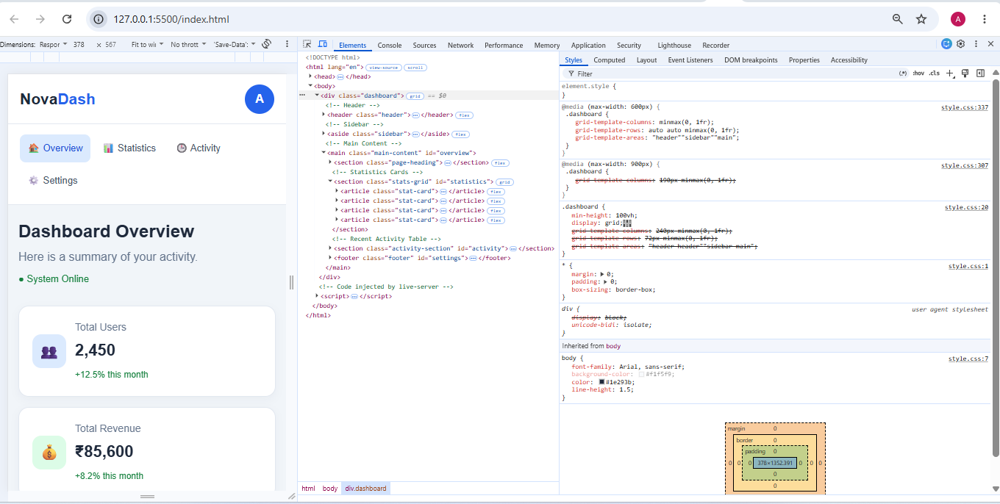
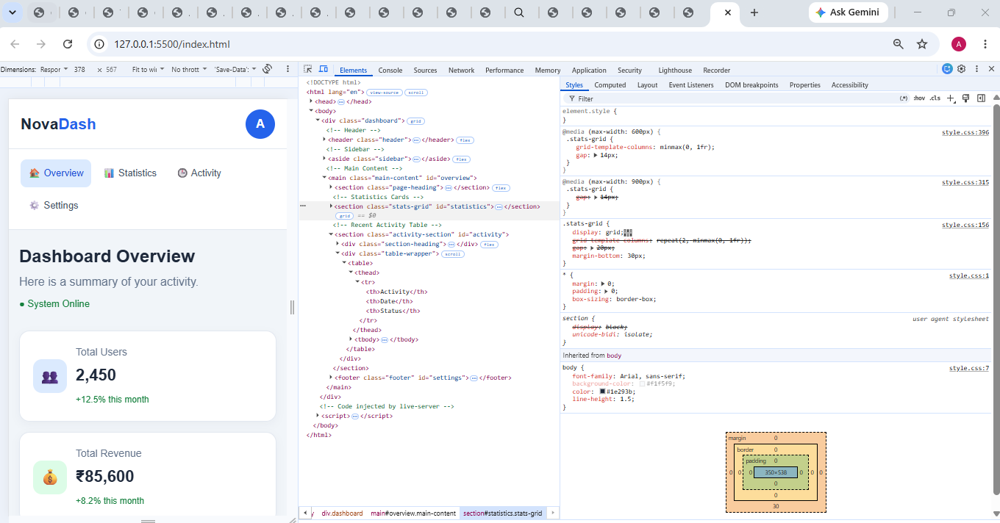
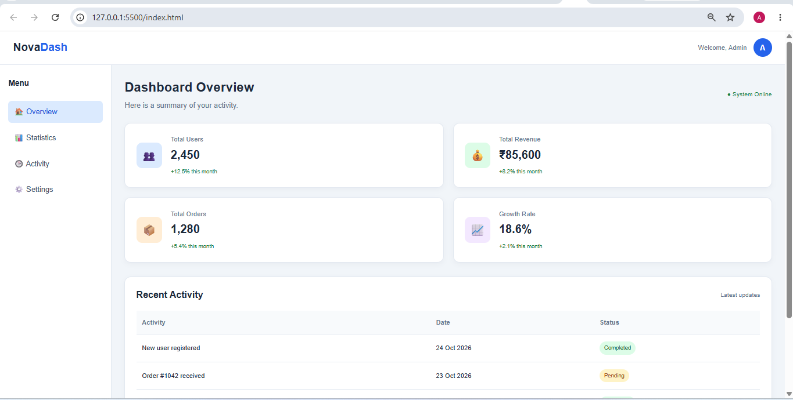
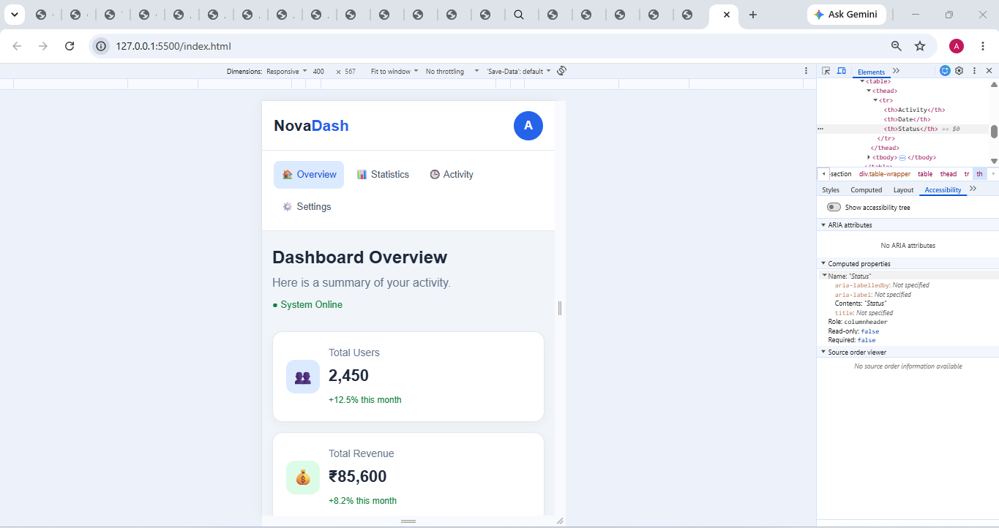

# Assignment 8.4 — Dashboard with Grid and Flexbox

## 1. Aim

To create a responsive dashboard webpage using CSS Grid for the overall layout and Flexbox to arrange the contents inside statistic cards.

## 2. Requirements

- Visual Studio Code
- A web browser such as Microsoft Edge or Google Chrome
- Basic knowledge of HTML5 and CSS3
- Browser Developer Tools

## 3. Theory

**CSS Grid** is a two-dimensional layout system used to arrange elements in rows and columns. In this dashboard, Grid organizes the header, sidebar, and main content.

**CSS Flexbox** is a one-dimensional layout system used to arrange elements in a row or column. In this dashboard, Flexbox aligns the icons, titles, and numbers inside the statistic cards.

The combination of Grid and Flexbox creates a structured, responsive, and easy-to-maintain dashboard.

## 4. Procedure

1. Create a folder named `Assignment-8.4`.
2. Create two files: `index.html` and `style.css`.
3. Write the HTML structure for the header, sidebar, statistics, and recent activity table.
4. Link the CSS file to the HTML document.
5. Use CSS Grid to organize the overall dashboard layout.
6. Use Flexbox to arrange the elements inside the statistic cards.
7. Add media queries to make the dashboard responsive on smaller screens.
8. Open the webpage using Live Server.
9. Use the browser's Grid inspector to inspect the layout.

## 5. Important CSS Properties Used

| Property                | Purpose                                                                |
| ----------------------- | ---------------------------------------------------------------------- |
| `display: grid`         | Creates the main dashboard layout and statistics grid                  |
| `grid-template-areas`   | Assigns areas to the header, sidebar, and main content                 |
| `grid-template-columns` | Defines the width and number of columns                                |
| `display: flex`         | Aligns items inside the header, sidebar, and statistic cards           |
| `justify-content`       | Aligns items along the main axis                                       |
| `align-items`           | Aligns items along the cross axis                                      |
| `gap`                   | Adds space between items                                               |
| `@media`                | Changes the layout for smaller screens                                 |
| `overflow-x: auto`      | Allows horizontal scrolling when the table is wider than its container |

## 6. Testing and Observation

1. Open `index.html` using Live Server.
2. Check that the header spans the top of the dashboard.
3. Verify that the sidebar appears on the left and the main content appears on the right on desktop screens.
4. Confirm that four statistic cards appear in a two-column Grid.
5. Inspect the cards to verify that their icons and text are aligned using Flexbox.
6. Resize the browser to a mobile width and check that the dashboard becomes a single-column layout.
7. Verify that the activity table stays inside its container and can scroll horizontally if necessary.

## 7. Result

The dashboard webpage was created successfully using CSS Grid for the overall layout and Flexbox for aligning content inside the statistic cards. Four statistic cards and a recent activity table were added. Media queries were used to make the page responsive on desktop, tablet, and mobile screens.

## 8. Conclusion

This assignment demonstrates how CSS Grid and Flexbox can work together to create a responsive dashboard. Grid organizes the major page sections, while Flexbox provides flexible alignment within individual components.

## Inspect dashboard screenshot

## Inspect .stats-grid screenshot

## Desktop view screenshot

## Mobile view screenshot

